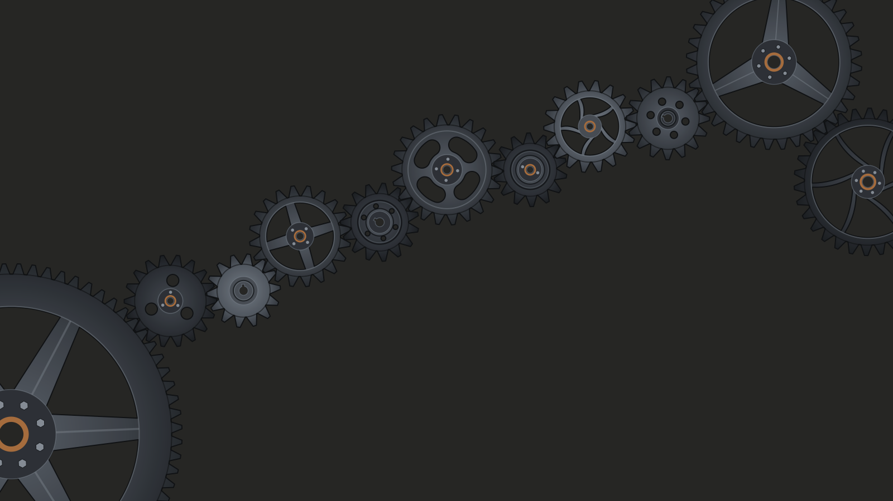
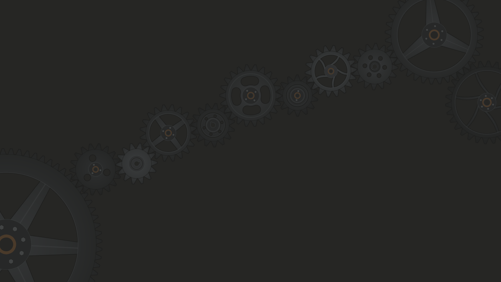
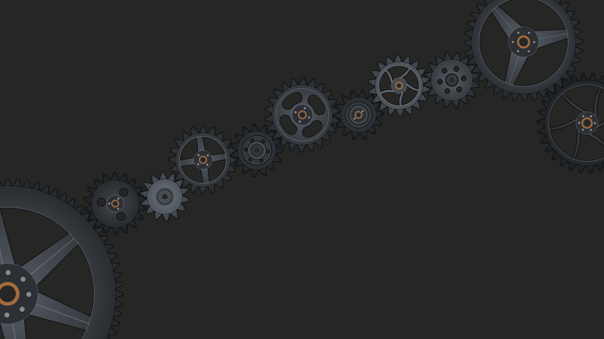
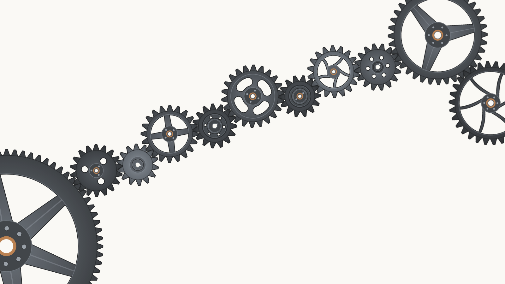
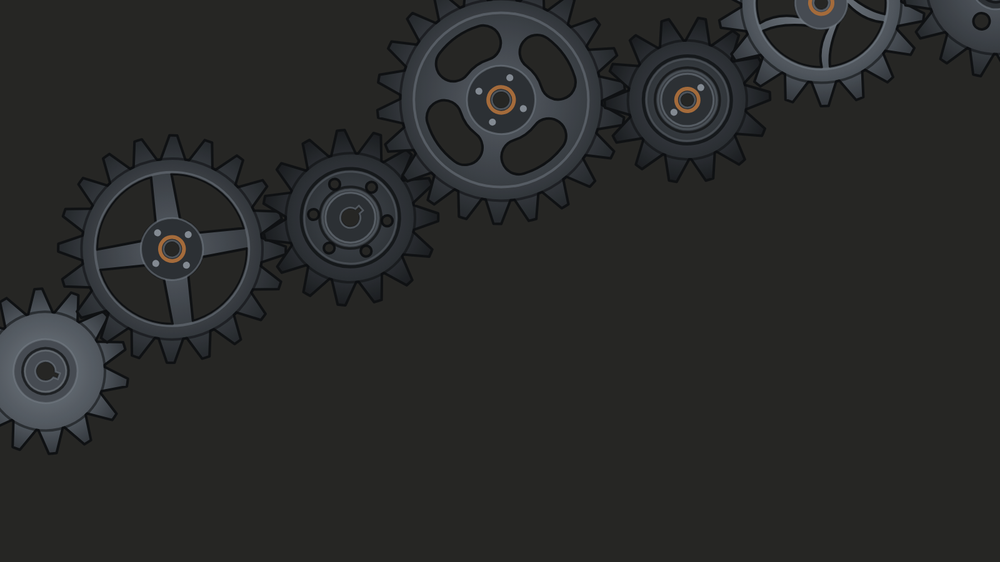

# Clockworks

A theme for the Claude desktop app: an iron gear train behind the conversation. It stands still while Claude waits for you and turns while Claude works. Part of [Claude themes](../../README.md).



| While Claude waits | While Claude works |
| --- | --- |
|  |  |
|  |  |



The pictures are the theme's own scene, rendered by `node tools/make-previews.mts`, over stand-ins for Claude's dark and light backgrounds: the scene has none of its own. In the app, the chat sits on a frosted panel down the middle, so the gears show most in the margins.

- **Idle:** muted. The train stands still at about a quarter strength.
- **While Claude works:** the gears spin up over about a second and come to full strength. The big flywheel turns once every 40 seconds, and each pinion turns as many times faster as the flywheel has teeth over its own, so the small ones always look busiest. When the reply ends, the train coasts to a stop over about two seconds and fades back.
- **The colours never change.** Only how visible the gears are and how fast they turn.
- **The storm** (on by default): while Claude works, the gears follow the tokens it writes, counted as they stream in from the main chat and from every subagent:

  | Level | When | Gears |
  | --- | --- | --- |
  | Waiting | Claude has written almost nothing for a few seconds: a long command, a build, a job it waits on | Creep at a quarter speed, a little over half strength |
  | Working | Claude writes at its usual pace | Turn steadily, the flywheel once in 40 s |
  | Storm | Claude writes a lot: two or more subagents at once, or a fast model writing a big file | 1.6 times as fast as working, full strength |

  Only what Claude writes counts (its replies, its thinking, what it passes to tools, such as the code of an edit), not the conversation that goes with every request. Each change eases in: the gears speed up or slow down from wherever they are. With `/clockworks storm off`, a turn keeps the one working speed.
- **The gears mesh for real.** The whole train has one tooth pitch, every centre is set so a tooth sits in a gap, and each wheel turns the opposite way to its neighbour at the ratio of their teeth, so nothing slips when the speed changes.
- **Every wheel is cast its own way:** a heavy flywheel with a thick rim, six broad tapered spokes and a hex-bolted hub; solid webs with lightening holes; a dished wheel; kidney slots; straight, curved and S-shaped spokes; keyed steel pinions; bronze bushings. Plain iron, blackened iron and steel take turns along the train.
- **A chime** when Claude finishes a reply: five clockwork ticks, each a little later and softer as the train runs down, then one small bell left to ring. About two seconds. Not played for a reply you stopped.
- **Claude's own colours and background.** The theme sets no palette, so the text, panels, code blocks and diffs keep Claude's own Light and Dark colours, and the gears have no background of their own: they turn straight over Claude's, in either mode. Iron, steel and bronze read on both. A dense frosted panel behind the chat, in Claude's own panel colour, keeps the gears from crossing the words. No status bar or band.

## Install

At the prompt of a Claude Code terminal session:

```
/plugin install clockworks --marketplace fredy-mederos/claude-themes
```

Answer `y` to add the marketplace, then pick a scope (user scope puts it in every session).

From a shell:

```bash
claude plugin install clockworks --marketplace fredy-mederos/claude-themes
```

In the desktop app, where `/plugin` does not run: click **+** next to the prompt box, then **Plugins**, **Add marketplace** with `fredy-mederos/claude-themes`, then **Add plugin**.

The gears show in the Claude desktop app, which draws a mod's backdrop. In a new session they appear once you send the first message. Keep one theme on at a time: turn Matrix Rain off with `/matrix off`.

## Update

Claude Code keeps its own copy of the marketplace and doesn't refresh it by itself, so `claude plugin update` alone reports the version you already have. Refresh the marketplace first, then update the theme:

```bash
claude plugin marketplace update claude-themes
claude plugin update clockworks@claude-themes
```

Then restart the app to load the new version.

## Commands

- `/clockworks off` turns the theme off, here and in new sessions. `/clockworks on` brings it back.
- `/clockworks sound off` silences the chime. `/clockworks sound on` brings it back.
- `/clockworks storm off` keeps the gears at one speed while Claude works, whatever it writes. `/clockworks storm on` brings back the waiting, working and storm levels.

## Good to know

- The train is drawn at a fixed size, 1600 by 900 pixels, centred on the window. A wider window shows all of it with room around it; a narrower one cuts the flywheel and the two wheels at the right alike.
- The app reloads the backdrop on each redraw: when a turn starts or ends and when the level changes, at most every 3 seconds. Each gear carries on from the angle it had reached.
- Resizing the window doesn't redraw the gears: the app asks again at each new size, and the theme hands back the same drawing. If the app still drops the backdrop while resizing, the theme draws it anew every 20 seconds, so the gears come back on their own.
- The storm follows the writing a few seconds behind: the rate is the average over the last 8 seconds, and the gears slow down only once Claude has written less for 3 seconds, so a short pause between two replies doesn't slow them.
- The app holds every animated background still when macOS Reduce Motion is on, when its background-animation setting is off, or when it's drawing without the GPU.
- The chime is `sounds/turn-end.wav`, synthesized by `tools/make-sound.py` (Python standard library only). Change the script and run `python3 tools/make-sound.py` to make your own.

## Files

- `hooks/register.tsx`: the look, the reactions to turns, the chime and `/clockworks`.
- `hooks/scene.ts`: the animated SVG backdrop (SMIL only, sized in window pixels), how each wheel is cast, and the turning clock.
- `hooks/gears.ts`: gear geometry (teeth, spokes, holes, slots, keyed bores) and the train's layout, set to mesh.
- `hooks/meter.ts`: the token meter behind the storm, and the levels it picks (the same as Matrix Rain's).
- `screenshots/`: the README pictures; `tools/make-previews.mts` remakes them (needs Node 22.18 or later and Chrome).
- `tests/`: run with `claude plugin test .`
