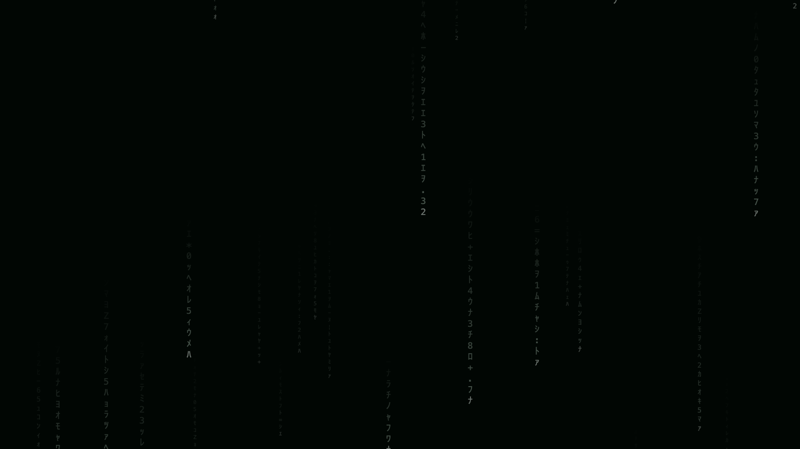
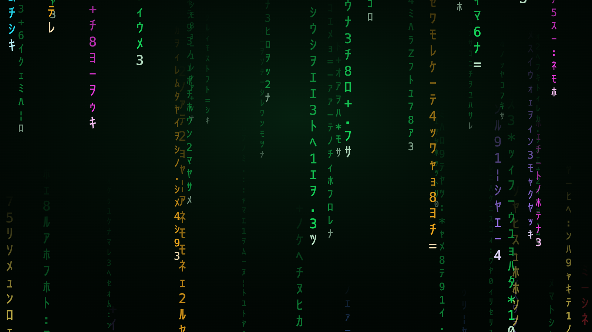

# Matrix Rain

A theme for the Claude desktop app: green code raining down behind the conversation. Part of [Claude themes](../../README.md).


| While Claude waits | While Claude works |
| --- | --- |
|  |  |



The pictures are the theme's own scene, rendered by `node tools/make-previews.mts`. In the app, the chat sits on a frosted panel down the middle, so the rain shows most in the margins.

- **Idle:** muted. About fifty dim, grey streams drift down very slowly, in three depths (small and faint at the back, larger at the front), on plain black.
- **While Claude works:** the rain turns green, a green light comes up behind it, and it brightens and speeds up about fourteen times, with more streams joining from the top. When the reply ends, the extra streams finish their fall and the rain slows again, with no jump.
- **Letters change as they fall:** a few letters along each trail flicker to new glyphs, and each stream's bright head scrambles. They change at the rain's own pace: slowly while idle, fast while Claude works.
- **Tool calls:** every tool call drops a handful of fast, bright streams in a colour for the kind of work:

  | Colour | Tools |
  | --- | --- |
  | Cyan | Read, Grep, Glob |
  | Magenta | Edit, Write |
  | Amber | Bash |
  | Violet | web and browser tools |
  | Gold | Agent |
  | Blue | other MCP tools |
  | White | everything else |
  | Red | a tool call that failed |

- **A chime** when Claude finishes a reply: a deep pulse, one low thump and a dark chord that breathes out, about a second long. Not played for a reply you stopped.
- A near-black green palette for dark mode, with soft, nearly white text and a dense frosted panel behind the chat, so the rain glows behind the conversation without crossing the words. No status bar or band.

## Install

At the prompt of a Claude Code terminal session:

```
/plugin install matrix-rain --marketplace fredy-mederos/claude-themes
```

Answer `y` to add the marketplace, then pick a scope (user scope puts it in every session).

From a shell:

```bash
claude plugin install matrix-rain --marketplace fredy-mederos/claude-themes
```

In the desktop app, where `/plugin` does not run: click **+** next to the prompt box, then **Plugins**, **Add marketplace** with `fredy-mederos/claude-themes`, then **Add plugin**.

The rain shows in the Claude desktop app, which draws a mod's backdrop. In a new session it appears once you send the first message.

## Commands

- `/matrix off` turns the theme off, here and in new sessions. `/matrix on` brings it back.
- `/matrix sound off` silences the chime. `/matrix sound on` brings it back.

## Good to know

- The app reloads the backdrop on each redraw: when a turn starts or ends, and at most every 3 seconds while tools run. Each stream carries on from where it was.
- The app holds every animated background still when macOS Reduce Motion is on, when its background-animation setting is off, or when it's drawing without the GPU. If the rain stops and the chat panel's blur is gone, quitting and reopening the app brings the GPU back.
- The chime is `sounds/turn-end.wav`, synthesized by `tools/make-sound.py` (Python standard library only). Change the script and run `python3 tools/make-sound.py` to make your own.

## Files

- `hooks/register.tsx`: the look, the reactions to turns and tool calls, the chime and `/matrix`.
- `hooks/scene.ts`: the animated SVG backdrop (SMIL only, sized in window pixels).
- `hooks/make-colors.js`: the palette builder from Claude Code's plugin-authoring kit.
- `screenshots/`: the README pictures; `tools/make-previews.mts` remakes them (needs Node 23 or later and Chrome).
- `tests/`: run with `claude plugin test .`
