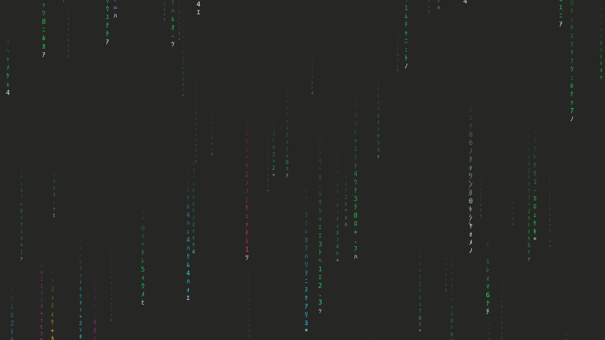
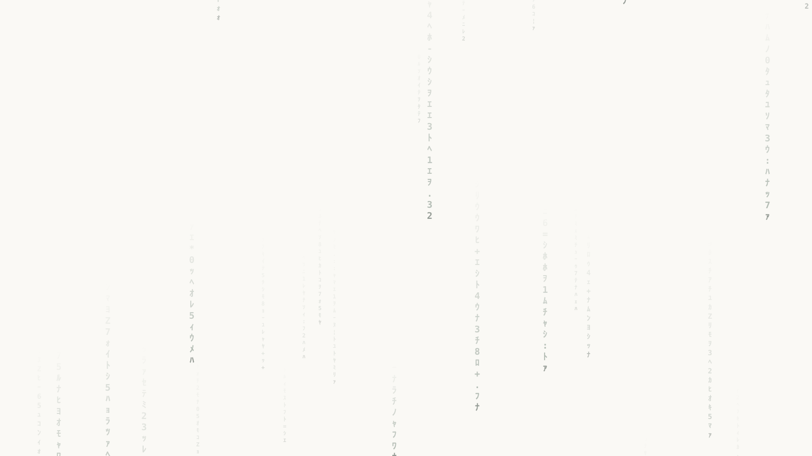
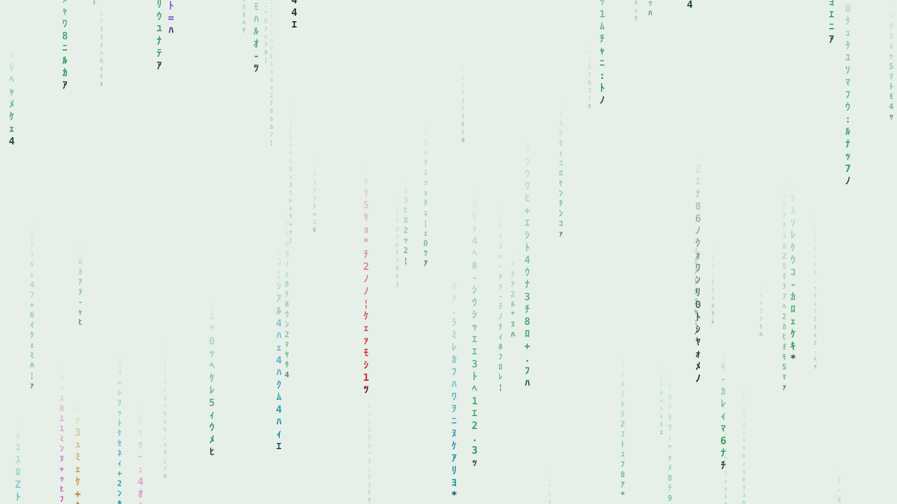

# Matrix Rain

A theme for the Claude desktop app: green code raining down behind the conversation, on black when Claude is in dark mode and on pale paper when it's in light mode. Part of [Claude themes](../../README.md).


| While Claude waits | While Claude works |
| --- | --- |
|  |  |
|  |  |


The pictures are the theme's own scene, rendered by `node tools/make-previews.mts`. In the app, the chat sits on a frosted panel down the middle, so the rain shows most in the margins.

- **Idle:** muted. About fifty dim, grey streams drift down very slowly, in three depths (small and faint at the back, larger at the front), on plain black (pale paper in light mode).
- **While Claude works:** the rain turns green, a green light comes up behind it, and it brightens and speeds up about fourteen times, with more streams joining from the top. When the reply ends, the extra streams finish their fall and the rain slows again, with no jump.
- **The storm** (on by default): while Claude works, the rain follows the tokens it writes, counted as they stream in from the main chat and from every subagent:

  | Level | When | Rain |
  | --- | --- | --- |
  | Waiting | Claude has written almost nothing for a few seconds: a long command, a build, a job it waits on | Light: the fifty streams of idle, green, with the light half up, about three times as fast as idle |
  | Working | Claude writes at its usual pace | The fast green rain above: about eighty streams |
  | Storm | Claude writes a lot: two or more subagents at once, or a fast model writing a big file | About a hundred streams, a quarter faster than working |

  Only what Claude writes counts (its replies, its thinking, what it passes to tools, such as the code of an edit), not the conversation that goes with every request. Idle stays as it is. Each change is smooth: new streams join from the top, and streams that leave finish their fall. With `/matrix storm off`, a turn keeps the one working pace.
- **Two looks, following Claude's appearance:** when you switch Claude between Light and Dark, the rain switches with it. Dark: phosphor green on black, each stream's head the brightest letter, a green light coming up behind while Claude works. Light: deep green ink on pale paper, each head the darkest letter, a soft green wash behind while Claude works. Everything else is the same in both: the levels, the storm, the changing letters, the tool calls and the chime. To keep one look whatever the mode, use `/matrix light` or `/matrix dark`.
- **Letters change as they fall:** a few letters along each trail flicker to new glyphs, and each stream's bright head scrambles. They change at the rain's own pace: slowly while idle, fast while Claude works.
- **Tool calls:** every tool call drops a handful of fast, bright streams in a colour for the kind of work:

  | Colour | Tools |
  | --- | --- |
  | Cyan | Read, Grep, Glob |
  | Magenta | Edit, Write |
  | Amber | Bash |
  | Violet | web and browser tools |
  | Gold | Agent |
  | Blue | other MCP tools |
  | White (ink in light mode) | everything else |
  | Red | a tool call that failed |

  In light mode each is a deeper shade, so it reads on paper.

- **A chime** when Claude finishes a reply: a deep pulse, one low thump and a dark chord that breathes out, under two seconds long. Not played for a reply you stopped.
- **Claude's own colours, untouched:** the text, panels, code blocks and diffs keep Claude's own Light and Dark colours. The theme only draws the backdrop and frosts the panel behind the chat (in Claude's own panel colour), so the rain shows behind the conversation without crossing the words. No status bar or band.

## Install

At the prompt of a Claude Code terminal session:

```
/plugin install matrix-rain --marketplace fredy-mederos/claude-themes
```

Answer `y` to add the marketplace, then pick a scope (user scope puts it in every session).

From a shell:

```bash
claude plugin install matrix-rain --marketplace fredy-mederos/claude-themes
```

In the desktop app, where `/plugin` does not run: click **+** next to the prompt box, then **Plugins**, **Add marketplace** with `fredy-mederos/claude-themes`, then **Add plugin**.

The rain shows in the Claude desktop app, which draws a mod's backdrop. In a new session it appears once you send the first message.

## Update

Claude Code keeps its own copy of the marketplace and doesn't refresh it by itself, so `claude plugin update` alone reports the version you already have. Refresh the marketplace first, then update the theme:

```bash
claude plugin marketplace update claude-themes
claude plugin update matrix-rain@claude-themes
```

Then restart the app to load the new version.

## Commands

- `/matrix off` turns the theme off, here and in new sessions. `/matrix on` brings it back.
- `/matrix light` keeps the rain deep green on pale paper and `/matrix dark` keeps it green on black, whatever Claude's appearance, here and in new sessions. `/matrix auto` follows Claude's appearance again, the default.
- `/matrix sound off` silences the chime. `/matrix sound on` brings it back.
- `/matrix storm off` keeps the rain at one pace while Claude works, whatever it writes. `/matrix storm on` brings back the waiting, working and storm levels.

## Good to know

- How the rain follows Claude's appearance: a theme isn't told which mode the app is in, so the backdrop carries both looks and a `prefers-color-scheme` media query inside it picks one. If the rain doesn't switch with the app, or the backdrop goes blank, `/matrix light` or `/matrix dark` draws one look with no media query at all.
- With a look kept by `/matrix light` or `/matrix dark`, the theme asks for that mode, but the desktop app keeps its own appearance setting for now, so Claude's colours follow that. The chat stays readable either way: its panel takes Claude's own colour for the mode it's in.

- The app reloads the backdrop on each redraw: when a turn starts or ends, when the rain changes level, and at most every 3 seconds while tools run. Each stream carries on from where it was.
- Resizing the window doesn't redraw the rain: the app asks again at each new size, and the theme hands back the same drawing. If the app still drops the backdrop while resizing, the theme draws it anew every 20 seconds, so the rain comes back on its own.
- The storm follows the writing a few seconds behind: the rate is the average over the last 8 seconds, the rain is redrawn at most every 3, and it steps down only once Claude has written less for 3 seconds, so a short pause between two replies doesn't thin it.
- The app holds every animated background still when macOS Reduce Motion is on, when its background-animation setting is off, or when it's drawing without the GPU. If the rain stops and the chat panel's blur is gone, quitting and reopening the app brings the GPU back.
- The chime is `sounds/turn-end.wav`, synthesized by `tools/make-sound.py` (Python standard library only). Change the script and run `python3 tools/make-sound.py` to make your own.

## Files

- `hooks/register.tsx`: the look, the reactions to turns and tool calls, the chime and `/matrix`.
- `hooks/scene.ts`: the animated SVG backdrop (SMIL only, sized in window pixels).
- `hooks/meter.ts`: the token meter behind the storm, and the levels it picks.
- `screenshots/`: the README pictures, dark and light; `tools/make-previews.mts` remakes them (needs Node 23 or later and Chrome).
- `tests/`: run with `claude plugin test .`
